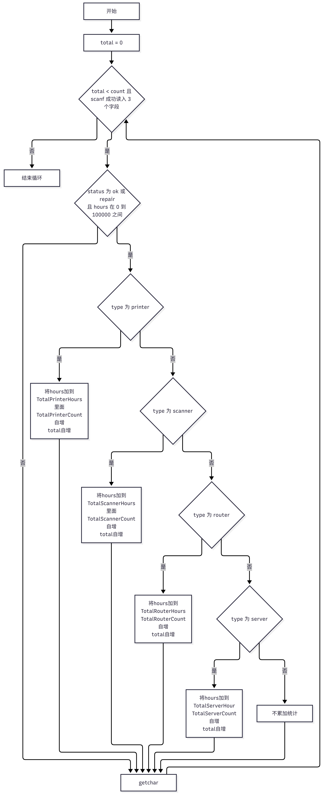
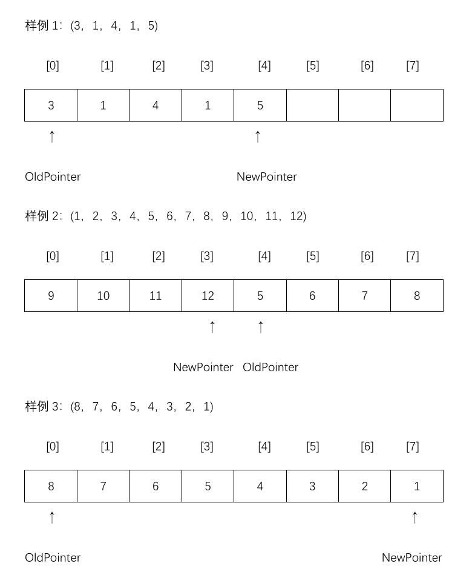

# 考核报告

——计算机科学与技术263班，刘宇浩

## 技术报告

### 基础入门部分

#### 第一关：找到入口

本任务其实比较简单，我们先用`ls`找到key.txt，用`cat`查看，我们就知道了密钥是什么，也就是MOON，接着看一下`exam --help`，看到用法是
```bash
exam -e [密钥]
```
并且试着运行后会看出来exam会硬编码读取本目录下的input，所以我们要做的很简单：用mv把input.bin改名为input，运行后我们ls一下可以看到一个output，把它改名成flag即可通关

#### 第二关：两段信号

这一关比较系统地考察了下对Linux一些常用指令的掌握，

和之前一样，我们要先用—help参数查看一下exam的用法

而我们知道，find可以用于递归查找文件，而grep可以搜索特定内容，于是一切都简单了：我们使用
```bash
find . -name “signal-A\*.\*”
find . -name“signal-B\*.\*”
```
就可以很顺利地找到这两个文件

找到这两个文件后，就该把它们拼接起来，这时候我们就该使用重定向符了，由于A要在前面，我们就执行
```bash
cat ./archive/2026/signal-A.bin \> input
cat ./inbox/signal-B.bin \>\> input
```
这样子input的准备工作就好了

接着我们要找到密钥，也就是含ACCESS_TOKEN的一个文件，这时候就需要grep和管道了，用find递归查找到所有文件，接着grep找到ACCESS_TOKEN,用管道连接起来，就是
```bash
    find . -name "\*.\*" \| grep -r "ACCESS_TOKEN"
```
我们就能很简单知道，密钥是STAR

然后就简单了，直接运行exam，把生成的output直接改名flag即可结束。

#### 第三关：读日志并修复输入

老规矩，进来先看一下exam的用法，可以发现还是一样要密钥，用ls总览一下后会发现一个key.txt，毫无疑问这个里面写的NOVA就是密钥，

接下来我们按照提供的日志路径去查看，很容易发现根本就没有日志：很显然，这需要我们先执行一遍exam后才有，自然，我们需要把这个input.bin改成input后再运行一下，通过日志看一下说什么。

日志里说的意思是，我们是19个字节，不能直接通过，字节数必须为4的整数倍，很显然我们需要一个空格，按常理而言这里要用sed，但我不会，所以我使用重定向插入一个空格
```bash
echo " " >> ./input
```
插入后就可以了，重新执行`exam`后把output改名flag就通过了

#### 第四关：让命令找到路

对于不太懂shell的我来说，这题比较难，所以我只能使用AI生成shell，所以以下的都是我对照AI的代码进行的解读，可能有所缺陷：

依照shell的编写规则，先用一行
```bash
#!/bin/bash
```
声明一下这个是bash脚本。

在容器里直接`echo $ROUTE_RESULT`的话我们会发现啥也没有，所以为了稳妥，我们假设这个是可能存在可能不存在，所以先if一下，这玩意有就`export`一下，没有就`export`成`"/workspace/flag"`

验证完`ROUTE_RESULT`后，我们就开始检验参数是不是两个，如果不是就`echo`一个`usage`，顺手把`ROUTE_RESULT`删掉一下，再退出64，

既然是两个参数，那下一步就该检验一下这两个参数是不是符合要求了，为了可读性好，我们定义`MODE`和`ITEM`这两个变量去存储这两个参数，

检验这两个参数需要用正则表达式筛选。

```bash
if [[ ! "$MODE" =~ ^(ok|retry|fatal)$ ]] || [[ ! "$ITEM" =~ ^[a-zA-Z0-9]{1,32}$ ]]
```

是不是符合要求，不符合要求一样，`echo`一个`usage`，顺手把`ROUTE_RESULT`删掉一下，再退出64，

好不容易整完了这两个参数，我们接下来就把配置加载一下，用`source`去把`job.env`里的东西引入进来，将`ACCESS_TOKEN`和`TASK_TOOL_DIR`分别`export`到全局区，接着，我们还需要把整个工具目录加入`PATH`便于我们执行

```bash
export PATH="$TASK_TOOL_DIR:$PATH"
```

OK，那么接下来我们只需要调用这个工具，捕获输出，保存退出码即可，我们使用OUTPUT接收输出，RC接收退出码

有了退出码，我们接下来就是用case看什么码干什么，不过，由于我们需要一个会出，所以我们采用`printf`后面加`\n`的形式以实现严格的格式与换行控制。

#### 第五关

本任务先判断n是否大于10000，如果是则程序返回1，防止出现越界问题，采取getchar函数消除前面的回车，防止读取失败卡死无法读取后面的正常数据。


### C/CPP进阶方向

#### 读数统计

本任务先判断`n`是否大于10000，如果是则程序返回1，防止出现越界问题，采取`getchar`函数消除前面的回车，防止读取失败卡死无法读取后面的正常数据。

接着我们把需要的四个变量`count`,`sum`,`min`,`max`定义出来并初始化一下，考虑到后面我们是通过比大小动态更新`min`和`max`，所以，我们把`min`初始化为`1000`，`max`初始化为`-1000`。接着就可以开始循环读取了

循环的控制我们通过`count`变量和`scanf`是否成功读取来控制，只要`scanf`还能成功读取且`count`没有达到`n`，就继续循环

我们将读取的数据存储在一个`temp`变量中，`count`变量表示实际读取的数目，每次读取一个后`count`就加一，并且分别将这个数与`min`和`max`对比，如果`temp>max`,就令`max=temp`。而如果`temp<min`，则令`min=temp`，同时把这个是数加入`sum`

循环结束后一切就简单了，我们只需要根据格式，把`count`，`sum`，`min`，`max`分别输出就可以了。

#### 设备巡检记录

本任务先消除掉读取count后残留的换行符，避免后续scanf无法读取，接着定义八个变量，分别为printer，scanner，router，server这四个分别对应的总时长与次数，接着进入循环。

在循环里，我们先检验一下scanf是不是读到了这三个数据，要是读不到就脱离循环，同时我们使用total变量控制循环次数，如果在scanf还能读取的情况下total还没达到输入的count，那么就持续循环读取。（以下为循环流程图）



读取到数据后，我们先对照一下status是不是ok或repair，以及time是不是在\[0,100000\]内，如果不是total不自增，跳入下一循环，是的话继续看前面type是啥，并把time加入对应的总时长，次数加1，total加1，没有继续下一循环，每次进入下一个循环都先用getchar清除一下换行符。

读取完所有的数据就该判断busiest是哪个了，我们先假定busiest是1(不初始化为0的原因是为了防止后面全都匹配不到导致无busiest，当然，我们还有另一种办法，将TempTime初始化为-1就可以了)，并定义一个TempTime变量初始化为0，用于比较，我们首先对比一下Temptime和printer的时间TotalPrinterHours，如果前者更多就保持busiest和TempTime不变，如果后者更多就把TempTime和busiest和后面那个靠齐，以此推下去将4个按顺序对比，就可以得到时长最多且最靠前的。

#### 固定窗口读数工具

本任务的处理十分简单，对i进行取CAPCITY的余（我个人认为，这里的8不能写死，定义这个CAPCITY是为了实现解耦，便于根据需求修改所需窗口大小），使得当i达到CAPCITY后可以回绕从下标0存储，覆盖掉最早的一个。

至于keep的控制，很简单，我们设计一个if，当keep没达到8就自增，达到了8就不自增

同时，我们定义一个NewPointer和OldPoint分别用于指向最新的和最旧的数据，在i未超过8时，keep正常增加，而当keep达到8后，keep不再增加，同时OldPointer指向对i+1取8的余数，这样OldPointer始终指向NewPointer前面的一个，最快被覆盖的就是最早的那个

以题目里的样例为例




#### 多文件统计工具

这个任务要求修复由多个文件组成的文件统计工具，在main()里，使用的格式是：

void print_report(int count, long long total, int smallest, int largest)

而在format.c和format.c中，参数顺序颠倒，我们要做的比较简单，就是对照main()里的调用类型，反过来修改format.h和format.c里参数列表里的类型，使之匹配

除了这个，我们还需要修改CMakeLists.txt，给add_executable里面加上format.c，并且加上这两句：

set(CMAKE_C_STANDARD 11)

set(CMAKE_C_STANDARD_REQUIRED ON)

第一行指定使用C11标准，第二行执行强制要求使用这个标准。

加上这两行后，整个任务就完成了。

自然，不要忘记把文件从c文件夹里拿出来。

## 感悟报告

### C/CPP进阶方向

#### 读数统计

在写这读数统计时，我最开始采取的方案是采用\`fgets\`读取一整行，再通过\`sscanf\`依次读取数据，由于\`sccanf\`无法自动移动，需要一个巨大的字符数组去接收，而且需要防止缓存区溢出，而且会因未知原因造成输出与预期不符合：

char buffer\[40000\];

getchar();

fgets(buffer,sizeof(buffer),stdin);

//printf("%s",buffer);

int max = -1000,min = 1000,count = 0,sum=0;

int temp = 0, offset = 0 ,size = 0;

while (count \< n && sscanf(buffer+offset,"%d%n",&temp, &size) == 1)

{

   
//由于sscanf无法自己移动所以需要我们用一个size来表示读取了多少个字符，并将其加到offset上

    offset += size;

    count++;

    sum += temp;

    if (temp\>max)

    {

        max = temp;

    }

    if (temp\<min)

    {

        min = temp;

    }

}

\`\`\`

所以在最后和AI讨论后改为采取\`scanf\`读取，更加简单（当然，前者一般在实际业务使用更多，但对我而言难度比较高，所以先采用\`scanf\`方案）

设备巡检记录

这一关也是问题比较多，原本我以为用scanf只要读取成功就一定返回1，但实际情况是输入足够数量的数据没有结束，经过询问AI，得知scanf的返回值取决于成功读取了几个数据，所以在此处，scanf的返回值应该为3。

还有，不知道是不是是太久没摸C语言了，我闹了两个笑话：一个是在switch里使用字符串，但其实switch里面只能用int，另一个是在C语言里，字符串的对比不能用==，要用strcmp()函数，当然，或许也可能是我以前做的程序很少出现和字符串打交道的情况，以前写switch
case时，经常用枚举来方便自己阅读

除了这个，在busiest上，前面技术报告里我也说了，本来是将busiest初始化为0的，根据对比时间来确定busiest是哪一个(要换我以前，估计又要开始写枚举了)，当然，由于查出了bug，AI建议我把代码改成busiest初始化为1，但事后我又想到另一种方法，也就是把TempTime初始化为-1，这样也可以防止这种全0的情况，不过由于已经提交了也不太好改了。

固定窗口读数工具

我敢说这是整个C/C++方向对我最友好的一关：除了最开始的回绕不明白什么意思，不过用AI查了一下就知道了这个是什么意思，一开始我想到的是队列，但是我们又不可能从头写一个队列：太费时间了，所以，我采用两个指针(说白了就是两个记录下标的变量，不是那种记录变量地址的指针变量)，一个指向最早的，一个指向最新的

不过在写关于这两个变量怎么动的时候，我又面临一个问题：在输入数据未达到8时，OldPointer不需要移动，而到8以后我们就要移动OldPointer，这个我后来想到了keep，利用keep是否小于8的两种情况来分别处理OldPointer的不同移动方法，

原本关于OldPointer的移动方法我也十分头疼，后来我想到，最早进来的也会最先被覆盖，那么哪个最快被覆盖哪个就是最先进来的，也就是i+1的取余。所以很快就完成了，by
the way，这估计是最快完成的一关。

多文件统计工具

关于多文件编程，虽然以前自己做程序时，也常常把各功能块分离，便于自己查找，不过由于以前比较依赖IDE，所以关于怎么把这几个文件放一起用的CMake我不太了解，自然又去补了一番课，在弄这个CMakeLists.txt时，我也闹了不少笑话，照抄hints.txt时，忘记把_CXX_改成_C_了，当然，由于我不懂逆向，所以我也不知道CMake是以一个什么样的心情看着这个前面说语言是C语言后面又说要CXX
11的标准的文件的(狗头保命)。

由于那天做这个时我前面在晚自习上刚完成固定窗口读数工具，所以我一股子劲地直接来对付这一关，所以甚至搞出了“把largest的类型改成long
long”的闹剧，好在最后是修复好了，也发现了这个类型的不匹配，其实主要还是心焦了，直接看着format.h时就开始直接修改了，后来仔细检查main调用print_report时才注意到这个问题，从头调整了一遍，至于过没过关……我在这都排了两天队了都，我还是不知道我现在是不是确实没有问题了。
